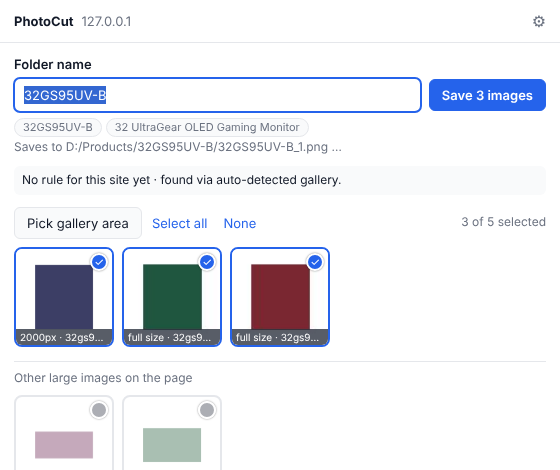

# PhotoCut: how to use

PhotoCut saves the product photos from the web page you're on, crops them and puts
them in a folder on your PC, named the way you choose.

## One-time setup (5 minutes)

1. **Unzip** `PhotoCut.zip` anywhere and double-click **`install.bat`**.
   It installs into your user folder. No admin rights are needed.
2. **Add the extension to Chrome**:
   1. Open `chrome://extensions`.
   2. Turn on **Developer mode** (top right).
   3. Click **Load unpacked** and choose `%LOCALAPPDATA%\PhotoCut\extension`.
      The installer opens that folder for you.
   4. Click the puzzle icon in the toolbar and **pin** PhotoCut.
3. **Settings**: right-click the PhotoCut icon, then **Options**:
   - **Output folder**, e.g. `D:\Products`. Every save goes into a new subfolder here.
   - **Shared site rules file**: the team's `rules.json`. It must be a path on your PC, see the next section.
   - **Your name**: shown next to the site rules you teach.

### The shared rules file (Google Drive)

A `drive.google.com/...` web link **can't** be used directly. Each person needs:

1. **Google Drive for desktop** installed and signed in. It's free from Google.
2. Access to the team folder, shared with your Google account.
   If it's in someone else's "My Drive", open it on drive.google.com and use
   **Add shortcut to Drive** so it appears on your PC.
3. In PhotoCut Options, browse to the file inside that folder, e.g.
   `G:\My Drive\PhotoCut\rules.json` or `G:\Shared drives\Team\PhotoCut\rules.json`.
   If the file doesn't exist yet, PhotoCut creates it the first time someone saves a rule.

When anyone teaches PhotoCut a site, Google Drive syncs the file and everyone gets the fix.

## Every day

1. Open the product page in Chrome.
2. Click the **PhotoCut** icon, or press **Alt+Shift+S**.
3. Check the **folder name**. It's filled in from the product code or title; click a grey suggestion or type your own.
4. Check the ticked images. Click an image to tick or untick it.
5. Press **Save** (or Enter). A few seconds later the folder opens with
   `<name>_1.png, <name>_2.png …`.

What happens to every image:
- The background is cropped away.
- It's scaled down to fit 3000×3000 if larger.
- It's padded with white up to 650×650 if smaller.
- It's saved as a real PNG under 5 MB.

Your originals on the website are never touched, and **existing files are never overwritten**.
If the folder already has images, the new ones continue the numbering. Tick
"Create a new folder instead" to get `<name> (2)`.

## When PhotoCut picks the wrong images (teaching a site)

- **Logos, banners or other products are ticked?** Untick them. Leave
  **"Remember these choices for this site"** ticked when you save, and next time those
  images are skipped automatically for everyone.
- **The product photos are missing, or random images were picked?** Click **Pick gallery area**:
  1. Move the mouse over the product photos on the page. A blue box shows the area under the mouse,
     with a label saying how many images are inside it.
  2. **Click** to lock that area. A bar appears at the bottom of the page.
  3. Use **+ Bigger** / **− Smaller** (or the ↑ / ↓ keys) until the box covers the main photo
     **and** its thumbnails, and the label shows the right number of images.
     Clicking somewhere else on the page starts again from there.
  4. Click **Use this area** (or press Enter). Then click the PhotoCut icon again if it doesn't open by itself.
  5. Check the images and press Save, with "Remember" ticked.

From then on, PhotoCut uses that area on every product page of that site, for the whole team.
A rule for `lg.com` covers all LG countries (`/za/`, `/uk/`, `/de/` …) as long as the pages
look the same.

## Problems

| Problem | Fix |
|---|---|
| "The PhotoCut app is not installed or not registered" | Run `install.bat` again, then reopen the popup. |
| "Shared rules file problem" | Check Google Drive for desktop is running and the path in Options is right. |
| An image shows in the error list after saving | The website refused that download. Try again, or save that image manually. |
| Images saved too small | The website only offers small versions. Check the image on the site itself. |
| After an update nothing changed | In `chrome://extensions`, click the reload arrow on PhotoCut. |
